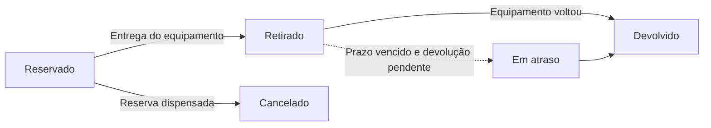

# Empréstimos no Portal PROEX

**Em poucos minutos, você aprende a reservar, entregar, devolver e reencontrar o histórico de um equipamento.** O exemplo usa um projetor fictício. Os nomes dos controles foram conferidos no Portal em 15/11/2026.

## Preciso pedir um empréstimo

No site da PROEX, use **Acesso Rápido → Solicitação de Empréstimo de Materiais e/ou Equipamentos**. O formulário institucional pede dados da ação que está em execução no SIGAA, material ou equipamento, quantidade, justificativa e previsão de retirada e devolução. Tenha também o número SIAPE e o código da ação à mão. Envie o pedido e aguarde o retorno da equipe. Após conferir a disponibilidade, a equipe autorizada pode registrar a reserva interna. [Página da PROEX](https://proex.ufg.br/) · [Formulário institucional](https://docs.google.com/forms/d/e/1FAIpQLSdUQVhf4ClakZKeRs1UznUHPwukGmztdeyTCTyaaW3lDU2oig/viewform).

## Preciso consultar ou operar uma reserva no Portal

No computador, abra **Empréstimos** no menu. No celular, toque em **Mais → Empréstimos**. A tela abre a **Agenda de empréstimos**.

- Escolha o projeto quando houver mais de um. Busque pelo nome do equipamento ou da ação e use **Situação** e o período para chegar ao cartão.
- **Reservado** separa o equipamento para um intervalo. **Retirado** indica que o equipamento saiu. **Em atraso** mostra os que saíram e ainda precisam voltar após o prazo. **Devolvido** encerra a saída. **Cancelado** encerra uma reserva antes da retirada.
- Se você tem só leitura e vê apenas **Relatórios**, abra **Relatórios → Assunto do relatório → Empréstimos**. Para a lista ou o termo de um empréstimo, solicite à coordenação o acesso correspondente. Você pode conferir seus vínculos em **Conta → Meus acessos**.
- A **Agenda** também tem a categoria **Empréstimos**. Pelo compromisso, use **Abrir empréstimo** se seu acesso abrir o registro.

### 1. Fazer a reserva

1. Toque **Nova reserva**. Em **Reservar equipamento**, confira o projeto do registro e selecione um equipamento ativo com uma unidade em estoque. Cada reserva interna registra um equipamento individual.
2. Preencha **Ação ou projeto atendido** e **Responsável pela retirada**. Use o campo de contato somente se a equipe precisar dessa informação. Escreva o nome da ação e o estado do bem nos campos livres. Dados pessoais e contato vão nos campos próprios.
3. Informe as datas de **Retirada prevista** e **Devolução prevista** em dia, mês e ano. Use hora de 24 horas, como **14:30**. A tela registra o horário escolhido no fuso do aparelho e a Agenda organiza a exibição no horário de Brasília. Confira o horário no cartão depois de salvar, principalmente quando estiver em outro fuso.
4. Toque **Confirmar reserva**. Procure **Reservado** na lista. Se aparecer conflito, escolha outro intervalo ou equipamento. Um equipamento já retirado e com devolução pendente também pode bloquear uma nova reserva.

Você também pode abrir **Projetos → ficha do projeto → Materiais e atividades → Empréstimos recentes → Reservar**. Nesse caminho, a confirmação se chama **Salvar reserva**.

### 2. Registrar a retirada

1. Na entrega do equipamento, dentro do intervalo combinado, encontre o cartão **Reservado** e abra **Registrar retirada**. Registre a saída quando o equipamento for entregue. Se o prazo passou e o bem já está com alguém, confirme o encaminhamento com a equipe antes de cancelar ou refazer.
2. Em **Atualização do empréstimo**, escolha **Registrar retirada**. Em **Condição e observações**, descreva o estado e os acessórios. Por exemplo, “Projetor funcionando, com cabo HDMI”.
3. Toque **Registrar atualização** e confira **Retirado**. Para uma reserva que deixou de ser necessária antes da entrega, escolha **Cancelar reserva** nesse mesmo menu.

### 3. Anexar o termo, quando houver

No cartão aberto, os termos ficam em **Registrar retirada** ou **Registrar devolução**. Nos encerrados, abra **Detalhes, termos e ocorrências**. Abrir a seção não muda a situação do empréstimo. Em **Foto ou PDF do termo**, selecione o arquivo e toque **Anexar documento**. O Portal aceita PDF, JPEG, PNG e WebP de até 4 MB. A consulta ao termo depende do acesso. **Enviar ao Drive** também exige conta e pasta autorizadas.

### 4. Registrar a devolução

1. Encontre o equipamento retirado e abra **Registrar devolução**. Se o formulário já estiver aberto, vá direto ao campo **Atualização do empréstimo**.
2. Selecione **Registrar devolução** e anote o estado do bem e dos acessórios recebidos.
3. Toque **Registrar atualização**. Confira **Devolvido**. A devolução volta a permitir o uso de um bem ativo quando não houver outro bloqueio. O histórico do empréstimo permanece e o saldo físico é acompanhado em Materiais.

### 5. Reencontrar o histórico

No cartão, toque **Ver histórico**. O Portal abre **Registros** filtrado pelo empréstimo. Confira reserva, retirada, devolução e ocorrências. A busca em Empréstimos considera equipamentos que ocupam alguma parte do período. Em Relatórios, o filtro atual usa a data prevista de retirada. Isso explica por que uma reserva que cruza dois dias pode aparecer em um recorte e faltar no outro.

## Se algo sair do esperado

| Situação | O que fazer |
| --- | --- |
| Não aparece Nova reserva | Confira os seus acessos para o projeto ou fale com a coordenação responsável. |
| O bem aparece na lista, mas a reserva é recusada | Confira estoque, condição, conflito e devolução pendente antes de tentar outro bem ou horário. |
| Mudou a hora ou o responsável antes da retirada | Confira a reserva atual com a equipe. Se precisar refazer, cancele a antiga e registre a nova. |
| A janela passou ou a retirada não abre | Confirme com a equipe se o equipamento saiu de fato. Para uma reserva que ficou sem retirada, a equipe pode cancelar. |
| Há avaria ou acessório faltando | Descreva o estado observado em **Condição e observações**. Use o canal autorizado da equipe para informações pessoais. |
| Não consegue abrir o termo ou o Drive | Confira seu acesso ao empréstimo e à pasta de destino. Peça à coordenação o encaminhamento adequado. |

O Guia da organização indica que prazo máximo institucional e autorização para empréstimo fora da UFG ainda precisam de confirmação. Consulte a equipe quando seu caso depender dessas regras.
