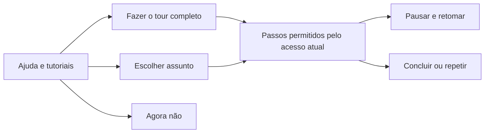

# Primeiros passos no Portal PROEX

Roteiro para os tutoriais. Referência do Portal em 15/11/2026, revisão `a6af672`. Os caminhos usam os rótulos da revisão conferida. O desenho dos cartões e seus controles orienta a próxima implementação.

[Trilhas por público](#trilhas-por-público) · [Mapa dos caminhos](#mapa-dos-caminhos) · [Ensaio da jornada inteira](#ensaio-da-jornada-inteira)

## Como o Rolê convida

> Oi, sou o Rolê. Quer conhecer o Portal? Você pode fazer um tour, escolher uma área ou voltar quando quiser.

**Fazer o tour completo** · **Escolher assunto** · **Agora não**

- O Início oferece o convite uma vez, sem tomar o foco nem abrir uma janela por conta própria. **Agora não** fecha a oferta. **Ajuda e tutoriais** permanece acessível em **Mais** no celular e na **Conta**. Coloque ajuda local também no atendimento de voluntários e nas páginas da ação pública.
- Quem usa o chat pode abrir a mesma ajuda pelo Rolê. O mascote, os textos, a navegação e o progresso funcionam com conteúdo roteirizado no próprio Portal. Consultar o tutorial não depende de IA ligada, chave, consentimento de provedor, widgets ou saldo.
- Cada cartão tem uma ação, um resultado que a pessoa consegue reconhecer e um caminho de volta. **Voltar**, **Próximo**, **Pausar** e **Sair** continuam disponíveis. Ao terminar, ofereça **Repetir esta parte** e **Ver outros assuntos**. **Retomar** volta ao último passo permitido. **Recomeçar** reinicia só a parte escolhida, com uma opção explícita para reiniciar o tour inteiro.
- **Experimentar** usa um exemplo fictício sem alterar registros de trabalho. **Abrir no Portal** guarda o ponto do tutorial, posiciona o foco no título ou controle visível e deixa qualquer gravação a cargo da pessoa. **Retomar** volta ao percurso. Se nenhum passo continuar disponível, mostre o motivo e volte à lista. Prefira passos que mostrem controles, filtros ou um cartão de exemplo. A trilha pode ser concluída mesmo com uma lista vazia.
- Para cada tela, resolva os passos pela sessão, projeto e capacidade atuais. Distinga consulta, edição, autorização e ações sobre anexos. Se um acesso mudar, reabra no próximo passo permitido. Na área de equipe, encaminhe a Conta → Meus acessos. Em voluntariado, encaminhe a Minha conta ou à coordenação. Na área pública, volte à página da ação ou ao atendimento da ação.
- Grave apenas identificador da trilha, versão, último passo, conclusão e estado do convite, por conta. A versão nova não deve apagar capítulos concluídos que mantêm o mesmo identificador. No público anônimo, progresso local opcional e sem vincular identidade, evento ou anexos desnecessários.

## Trilhas por público

O perfil inicial sugere a ordem. As permissões reais definem o que aparece. A mesma pessoa pode, por exemplo, cuidar de materiais de um projeto e ter só leitura em outro. O rótulo bolsista não define acesso.

| Público | Ordem e exercício final |
| --- | --- |
| Administração geral ou da organização | Conta e escopo → Meu trabalho → Projetos → Demandas e Equipes → Agenda → Pessoas e acessos → operações autorizadas. Ver o alcance de uma designação e de um acesso e explicar a diferença. A administração de uma organização fica no seu escopo. |
| Gestão de projeto | Meu trabalho → Projetos → Demandas → Equipes → Agenda → operações autorizadas. Encontrar o compromisso da ação, a demanda associada e quem cuida dela. |
| Responsável por materiais | Materiais → Projetos → Agenda de materiais → Meu trabalho e Demandas, conforme acesso. Identificar saldo físico, reserva e disponível antes de preencher uma movimentação de exemplo. |
| Responsável por empréstimos | Empréstimos → Agenda → projeto e histórico. Reconhecer se um equipamento está reservado, retirado ou devolvido e simular a próxima ação. |
| Operação de evento | Dinâmicas → ação autorizada → atendimento e retirada de brinde. Reconhecer o evento e conferir um código fictício. A conta com só operação não tem Agenda por essa função. |
| Leitura, incluindo bolsistas sem gestão | Conta → Projetos e Relatórios → Meu trabalho. Encontrar o que lhe foi atribuído. Quando houver autorização específica por demanda, mostrar apenas a atualização permitida. |
| Voluntariado de uma ação | Convite → ação e prazo → Atendimento presencial → Brindes, conforme autorização → Minha conta. Mostrar o que fazer quando o acesso expirar. |
| Participante | Link ou QR da ação publicada → Entrar para participar → cadastro ou confirmação, quando oferecidos → participação. Na ação presencial, mostre o Código do atendimento antes de jogar. Depois, quando houver prêmio, mostre o Comprovante de brinde e como retirar. Mostre atendimento assistido quando oferecido. |

O convite para a equipe usa o e-mail convidado e o recorte concedido. O convite de voluntário é da ação e tem prazo. A entrada de participantes usa a área pública, sem menus internos. Quando alguém pergunta por uma área ausente, indique **Meus acessos** ou a coordenação. Equipes e atribuições organizam o trabalho. O direito de abrir ou alterar registros vem da autorização concedida.

## Roteiro dos cartões

Os textos em itálico são falas do Rolê. Use como base editável após conferir os rótulos na conta que estiver em teste.

| Parte | Fala e passos no Portal | A pessoa conseguiu quando… |
| --- | --- | --- |
| Encontrar os controles | *No celular, a barra mostra os atalhos principais e Mais abre a lista. No computador, use o menu à esquerda.* Na área de equipe, abra **Conta → Meus acessos** e encontre um papel ou projeto. No celular, use o avatar e **Minha conta e senha**. Mostre como fixar um módulo usando o alfinete quando aparecer. | Ela sabe voltar ao Início e localizar o menu sem ajuda. |
| Meu trabalho | *Aqui você vê o que chegou para você e para suas equipes.* Em **Suas atribuições**, escolha projeto e alterne **Todas**, **Diretas** e **Por equipe** quando essas opções estiverem disponíveis. Abra uma atribuição e localize o prazo. Diferencie demandas pontuais de responsabilidades contínuas. | Ela abre a demanda ou explica o que mudar no recorte se a lista estiver vazia. |
| Projetos | *Abra a ficha do projeto para reunir atividades, equipe e materiais.* Use a busca e o recorte. Toque **Acessar projeto** e encontre **Cronograma**, **Materiais e atividades** e **Links e documentos**, conforme o acesso. Se aparecer, fixe o projeto pelo alfinete. | Ela encontra uma atividade e volta à ficha sem perder o projeto escolhido. |
| Demandas | *Escolha o projeto e use os filtros para encontrar o que está pendente.* Use **Buscar e filtrar**, estado e prioridade. Abra uma demanda e veja seu histórico. Para quem tem edição, mostre onde criar e editar com um exemplo fictício. Ensine **Somente demandas gerais** apenas se a opção aparecer para a organização administrada. | Ela abre a demanda certa e distingue atribuição, edição e histórico. |
| Equipes | *Uma equipe pode acompanhar mais de um projeto.* Escolha organização ou projeto e abra uma equipe. Confira integrantes e demandas no recorte. Só quem tem a ação permitida recebe o passo **Nova equipe**. A trilha pode mostrar **Quem cuida de cada área** na ficha do projeto e o organograma à gestão autorizada. | Ela diferencia integrantes, unidades e projetos atendidos pela equipe. |
| Agenda | *Escolha o período, a categoria e o dia.* Mostre **Filtrar período e contexto**, **Compromissos de…** e **Ver todo o período**. Indique os horários em Brasília. Abra um compromisso na área de origem quando houver link e acesso. Mostre as exportações do recorte para quem as vê. | Ela acha um compromisso e consegue voltar do detalhe para o recorte. |
| Materiais | *O saldo mostra quanto existe. Disponível mostra quanto pode ser usado agora.* Abra o catálogo e confira material, saldo, reserva e condição. Ensine **Registrar movimento** só a quem pode operar, com origem, destino e referência quando o formulário pedir. Brindes e kits ficam no contexto de quem pode gerenciá-los. | Ela explica o saldo e encontra o histórico certo sem registrar movimento real. |
| Empréstimos | *Uma reserva separa o equipamento no horário combinado. Registre a retirada e, quando voltar, a devolução.* Use a [trilha de Empréstimos](GUIA-EMPRESTIMOS.md). Para quem só consulta, abra o relatório permitido. | Ela identifica a situação, o prazo e o próximo passo sem alterar um registro real. |
| Dinâmicas | *Comece pela ação certa.* Em **Operação presencial**, selecione a ação e confira **Roleta e dado** e **Retirada de brinde** quando disponíveis. Demonstre o código e a confirmação com uma situação fictícia. A preparação de regras, estados e brindes fica no capítulo da gestão. | Ela escolhe a ação e reconhece o que confirma a entrega. |

**Cartão de exemplo — Empréstimos · 2 de 4**

> No exemplo, o projetor aparece como Reservado. Abra Ver histórico para conferir quando a reserva foi criada.

**Você verá** o registro da reserva. **Voltar** · **Experimentar** · **Próximo** · **Pausar**. Ofereça **Abrir no Portal** como ação separada para quem tem acesso.

## Mapa dos caminhos

Use o percurso mais curto para a tarefa. No celular, procure o atalho fixado e, se ele não estiver na barra, abra **Mais**. Para **Conta**, abra o avatar e toque em **Minha conta e senha**. No computador, use o menu lateral. Na página pública e no atendimento exclusivo de voluntários, use os controles da própria página.

- [Começar e conferir o próprio acesso](#começar-e-conferir-o-próprio-acesso)
- [Organizar o trabalho](#organizar-o-trabalho)
- [Localizar compromissos e registrar uma atividade](#localizar-compromissos-e-registrar-uma-atividade)
- [Movimentar materiais e emprestar equipamentos](#movimentar-materiais-e-emprestar-equipamentos)
- [Preparar ou atender uma dinâmica](#preparar-ou-atender-uma-dinâmica)
- [Consultar, exportar e pedir ajuda](#consultar-exportar-e-pedir-ajuda)
- [Ensaio da jornada inteira](#ensaio-da-jornada-inteira)
- [Conferência no código e aceite do roteiro](#conferência-no-código-e-aceite-do-roteiro)

### Começar e conferir o próprio acesso

1. Em um convite da equipe, entre com o e-mail convidado e confira a organização e o projeto antes de seguir. Após entrar, use **Conta → Meus acessos** e reconheça pelo menos um vínculo. Se o acesso acabou de mudar, toque em **Atualizar** e volte ao projeto pela lista autorizada. Se o vínculo não aparecer, procure quem enviou o convite.
2. No **Início**, mostre o próximo passo da pessoa e como voltar ao módulo de origem. Em **Meu trabalho**, faça o exercício de procurar a mesma atribuição em **Diretas** e **Por equipe**. Teste uma pessoa que recebeu a mesma tarefa pelos dois caminhos e confirme que ela consegue identificar de onde veio. Explique a diferença entre demanda com prazo e responsabilidade contínua, que indica quem cuida de uma frente.
3. No caso de gestão, use **Projetos → Acessar projeto → Quem cuida de cada área → Acessos do projeto**, quando disponível, ou **Pessoas e acessos** com o projeto selecionado. Use **Qual acesso escolher?** antes de simular um convite. Faça a pessoa escolher o menor acesso que atende a tarefa e reler projeto, função e destinatário. Administração do Portal, administração da organização e gestão de projeto têm alcances diferentes. A gestão do projeto escolhe apenas entre funções e destinos autorizados para aquela conta.

**Prova do passo** · A pessoa é gestora em um projeto fictício e leitora em outro. Ela identifica os dois vínculos, aponta onde explicaria a diferença e encontra o canal para solicitar um ajuste.

### Organizar o trabalho

| Tarefa | Caminho e decisão | O que conferir ao voltar |
| --- | --- | --- |
| Encontrar ou editar uma ficha | **Projetos → Acessar projeto**. Use a busca e confira unidade, situação e projeto. **Editar projeto** aparece para quem pode alterar a ficha. **Todos os projetos** volta ao catálogo. | Reabra o mesmo projeto. Confira o campo alterado e preserve os vínculos existentes. Organização, unidade responsável e relação entre programas e projetos ajudam a localizar o trabalho. Os acessos são conferidos por projeto. |
| Criar e acompanhar uma demanda | **Demandas → Buscar e filtrar → Projeto**. Para editar, abra o cartão e toque em **Editar demanda**. Para criar, selecione o projeto e use **Nova demanda**. Explique título, responsável e prazo com um caso simples. Mostre a passagem de **Aberta** para **Em andamento**. Em **Bloqueada**, peça que a pessoa identifique o que falta. Mostre **Concluída** quando o trabalho terminar e **Cancelada** quando ele for interrompido. A administração da organização pode escolher **Somente demandas gerais** para tratar trabalho que não pertence a um projeto. | Abra **Histórico da demanda** e verifique o estado e a nota após salvar. Teste filtro sem resultados e mostre como limpar a busca ou trocar o projeto. |
| Acompanhar e responder com acesso limitado | No cartão, confira o que está disponível. Um leitor atribuído pode acompanhar. Para responder ao checklist ou atualizar andamento, a gestão usa **Autorizar atualizações nesta demanda**. Oriente o leitor a responder somente ao que aparece. Se concluída ou cancelada, encaminhe dúvida de reabertura à gestão. | O leitor responde na demanda autorizada. Antes da autorização, após revogação ou em outra demanda, a atualização é recusada. Um checklist aberto pode impedir a conclusão. |
| Entender quem atua em uma equipe | **Equipes → Organização → Projeto**, conforme o alcance. Abra uma equipe e leia **Projetos com atuação registrada** e **Demandas da equipe**. Uma equipe pertence à organização e pode atuar em vários projetos por demandas e responsabilidades. Quem usa um recorte de projeto vê somente as equipes relevantes e os integrantes autorizados para aquele projeto. | A mesma equipe aparece em dois recortes quando tem atuação nos dois. Para ver o conjunto da organização e usar **Nova equipe**, use a conta que a administra. **Pessoas e acessos** concede vínculos. **Equipes** organiza o trabalho. |
| Designar uma frente recorrente | **Projetos → Quem cuida de cada área**. Com a gestão autorizada, simule a designação de uma pessoa ou equipe para Projetos, Materiais, Empréstimos ou Dinâmicas, conforme permitido. Consulte **Meu trabalho → Responsabilidades** na conta designada. | O responsável encontra a frente no projeto certo. Confirme na conta restrita se o acesso de leitura e edição continua vindo dos vínculos concedidos. |

### Localizar compromissos e registrar uma atividade

- **Consultar** · Em **Agenda**, filtre período, projeto ou unidade e categoria. Toque no dia e, no celular, no atalho **Ver … compromissos do dia** quando aparecer. Em **Compromissos de…**, combine **Categoria dos compromissos** com a busca do período. Use **Ver todo o período** para limpar só a seleção do dia. Quando existir link no compromisso, abra a área de origem. Os documentos de Agenda acompanham o recorte visível. O arquivo de calendário **.ics** segue período, categoria, unidade e projeto, inclui cancelamentos e tem finalidade de importação.
- **Planejar** · Para uma atividade do projeto, comece em **Projetos → Acessar projeto → Cronograma → Atividade** com a conta gestora. Reabra o mesmo compromisso na Agenda e confira dia e hora de Brasília. Para distribuir trabalho, use **Frentes → Checklist de atividade**. Escolha um modelo, indique como saber que cada etapa terminou e atribua a frente. Se a atividade for cancelada, confira os checklists já vinculados e explique que a criação de um novo checklist fica indisponível.
- **Registrar** · Abra **Registros e fotos** a partir da atividade. Na aba certa, toque **Novo registro da atividade**, escreva o que aconteceu e use **Salvar registro e continuar**. Depois, use **Usar câmera** ou escolha um arquivo. Para um registro existente e editável por aquela pessoa, procure **Adicionar documentos ou fotos**. Reabra o registro e confira a foto. Pelo menu **Registros**, se aparecer **Cadastro de registros restrito neste projeto**, confirme o projeto em Meus acessos e encaminhe à coordenação. Se o Portal direcionar ao histórico de alterações, alterne de **Alterações** para **Registros e fotos**.
- **Delegar cobertura** · No checklist aberto da atividade, a gestão pode autorizar a pessoa atribuída a criar registros e anexar fotos ou PDFs aos próprios registros da atividade. Teste resposta, criação e anexos como ações distintas. Abra a mesma atividade como outro leitor. Quando houver **Vídeos da atividade**, a gestão consulta a pasta vinculada ao projeto. O Google Drive usa a conta que está aberta e aplica o compartilhamento daquela pasta. Revise o [ensaio de ação e acessos](QA-ACOES-E-PERFIS.md) para testar a câmera, os anexos e a revogação.

### Movimentar materiais e emprestar equipamentos

| Situação | Percurso que o tutorial ensina | Resultado visível |
| --- | --- | --- |
| Preciso conferir o que tenho | **Materiais → Catálogo e estoque**. Escolha o projeto, abra a ficha e compare saldo físico, reserva e disponível com a mesma unidade de medida. Para comparar origem e destino, abra **Consumo e unidades**. Use um exemplo em que o saldo físico seja maior que o disponível. | A pessoa aponta o número que pode usar imediatamente e encontra o histórico com o lado da movimentação. |
| Recebi materiais ou preciso corrigir uma contagem | Use **Registrar movimento → Um material** e abra a ficha. Escolha a operação que corresponde ao fato. Informe quantidade, motivo e, quando pedido, origem ou referência. Se o registro anterior estiver errado, use a correção ou o desfazer na própria ficha, quando permitido. | A ficha mostra a quantidade resultante e rastreia o movimento ou sua revisão. O exercício não envolve estoque real. |
| Vou entregar vários itens juntos | Em **Registrar movimento → Vários de uma vez**, escolha **Entrega ou distribuição** ou **Uso pela equipe**, informe o destino e confira a quantidade de cada item. A saída conjunta exige materiais elegíveis do mesmo projeto e o mesmo destino e motivo. Recebimentos e ajustes de contagem usam a ficha de cada material. | A confirmação mostra as linhas e o destino. Cada ficha mostra sua parte da saída. Em simulação de saldo insuficiente, nenhuma linha é confirmada. |
| Preciso reservar, entregar ou receber um bem | **Empréstimos → Agenda de empréstimos**. Use a [trilha de Empréstimos](GUIA-EMPRESTIMOS.md#preciso-consultar-ou-operar-uma-reserva-no-portal). A próxima ação depende da situação e do prazo. **Reservado** permite agir antes da retirada. **Retirado** ou **Em atraso** puxa a devolução. Encerrados continuam consultáveis em **Ver histórico** e, conforme acesso, em **Detalhes, termos e ocorrências**. | A pessoa diferencia reserva, retirada, atraso e devolução. Um leitor que só dispõe de **Relatórios → Empréstimos** consegue consultar seu recorte e identifica com quem confirmar uma operação ou a abertura de um termo. |

### Preparar ou atender uma dinâmica

1. **Preparação pela gestão** · Em **Dinâmicas → Nova dinâmica**, escolha projeto, janela e local e salve um rascunho. Em **Roleta e dado**, confira as regras e os vínculos com materiais. Se a dinâmica distribuir prêmios, prepare os kits nos materiais autorizados e confira a oferta antes de ativar. Um rascunho fica na área interna. A página pública lista as ações publicadas. Uma ação publicada que foi pausada ou encerrada pode continuar visível pelo estado atual. Confira estado e horário antes de direcionar alguém ao jogo.
2. **Atendimento** · Em **Dinâmicas → Operação presencial**, selecione a ação. Se a pessoa tem **Código do atendimento**, localize a participação antes de jogar. Quando houver prêmio, o código do **Comprovante de brinde** segue para **Retirada de brinde**. Confirme no sistema antes de entregar. Repita com um código já entregue e confira que o Portal sinaliza a repetição. Se a ação não estiver ativa ou no horário e o atendimento for recusado, procure a coordenação daquela ação.
3. **Voluntário e participante** · A pessoa com acesso de voluntariado entra pelo convite daquela ação, confere a validade em **Minha conta** e vai direto ao balcão. Se o vínculo expirar, mostre como pedir orientação à coordenação. A pessoa participante entra pelo catálogo público **/events** ou pelo link e QR da ação. Ensine o caminho que a ação oferece e o local de atendimento quando faltar conta ou celular. Use o exemplo sem prêmio para validar que o tutorial funciona para quem só participa.

### Consultar, exportar e pedir ajuda

| Se a pessoa quer… | Mostre… |
| --- | --- |
| Levar os dados de um projeto | Na ficha, **Montar relatório e baixar PDF → Baixar o relatório**. No montador, confira as seções, o período e a prévia. Em **Relatórios** ou **Relatórios do projeto**, selecione **Assunto do relatório** e o recorte para baixar os dados disponíveis. As seções permitidas podem variar por projeto e função. Se faltarem linhas ou se houver aviso de consulta, confirme o recorte antes de compartilhar. |
| Convidar ou confirmar presença | **Convocações**. Quem gerencia a ação usa **Criar convocação** e confere o contexto antes de compartilhar o convite pelos canais do projeto. O destinatário usa o link da convocação. Este fluxo responde pela presença na ação e tem finalidade própria em relação ao convite de acesso ao Portal. |
| Consultar procedimento da equipe | **Gestão → Guia da organização**, quando disponível. Procure o processo pelo nome da tarefa. Para dados de um registro específico, abra a área do Portal que o mantém. |
| Contar um problema da página | No rodapé, toque em **Sugestão ou problema**. Em **Comunidade** existe retorno identificado à gestão e, para o público habilitado, **Ouvidoria anônima**. Em um exemplo de retorno identificado, descreva tela, projeto e o que esperava ver com dados fictícios. |
| Ajustar perfil ou integração | **Conta** reúne perfil, senha, preferências pessoais e Meus acessos. **Configurações** reúne ajustes habilitados para a administração e para quem pode configurar IA. Mostre **Chaves e modelos**, **Planilha Google**, **Pastas do Drive** e **Backup** apenas quando cada entrada existir e fizer parte da função. O tutorial usa exemplos e ajuda local mesmo se não houver provedor de IA configurado. |

## Ensaio da jornada inteira

Use **Oficina de demonstração**, uma atividade em projeto fictício, com **Comunicação de teste**, um projetor e duas categorias de materiais. Prepare outro projeto fictício com nomes parecidos para testar se filtros, vínculos e atalhos preservam o recorte. Reutilize o mesmo exemplo nos capítulos. Quem abriu só Empréstimos recebe o contexto mínimo no primeiro cartão.

| Momento | Pergunta inicial | Caminho principal e troca de público |
| --- | --- | --- |
| Antes da atividade | “Quem prepara a sala, a cobertura e os materiais?” | A gestão abre **Cronograma → Frentes**, escolhe um checklist de acordo com a necessidade e atribui os passos. **Meu trabalho** mostra as atribuições. A gestão confere se cada pessoa pode abrir o compromisso. |
| Antes da retirada | “O projetor está disponível das 14h às 16h?” | Empréstimos consulta o conflito no período e simula a reserva. Materiais confere o disponível e prepara uma saída com destino e referência fictícios. Cada conta abre só a operação autorizada. |
| No dia | “Como registro a entrega, o atendimento e uma foto?” | Empréstimos registra a retirada. O operador ou voluntário autorizado atende na ação e confirma a retirada de brinde quando houver. A pessoa com cobertura abre **Registros e fotos** a partir da atividade e anexa ao próprio registro. Faça a trilha no celular, com um arquivo sintético para chegar ao mesmo resultado quando a câmera não estiver disponível. |
| Depois da atividade | “Como fecho o trabalho e encontro a evidência?” | Empréstimos confere a devolução e o histórico. A gestão confere **Demandas** e **Alterações**, filtra os registros da atividade e monta um relatório autorizado. A pessoa consegue explicar de qual projeto, período e categoria veio cada dado. |

## Conferência no código e aceite do roteiro

As trilhas são sugestões editoriais. O acesso real de cada passo vem da sessão, do contexto e da resposta atual do Portal. Ao implementar, ligue cada passo ao destino e à ação que ele ensina. Use identificadores estáveis para os passos, e os rótulos atuais para o texto. Quando o Portal estiver sem dados ou o controle estiver indisponível, use a alternativa do mesmo capítulo. Com permissões diferentes em dois projetos, altere apenas os passos do projeto selecionado.

| Recorte de teste | Decisão a provar | Onde conferir |
| --- | --- | --- |
| Administração do Portal, de uma organização e gestão de projeto | A primeira tem alcance global. A segunda administra a própria organização. A terceira gerencia o projeto e pode agir sobre pessoas nas funções subordinadas permitidas, sem abrir a gestão de outra organização. Criar equipe e operar demandas gerais requer gestão da organização. | [Papéis e delegação](../lib/access.ts#L33) · [Rótulos da Conta](../lib/team-access-labels.ts#L1) · [Regras de equipes e demandas](../lib/follow-up/scope.ts#L7) |
| Materiais, Empréstimos, Operador de evento em projeto | Os três podem editar demandas no projeto em que têm o vínculo. Cada função tem suas próprias operações nos outros módulos. Operação de evento pode ter entrada em Materiais para entrega. Sem outra função que habilite Agenda, o operador fica sem Agenda. Verifique botões e recusa pelo servidor. | [Menu e acesso por projeto](../app/portal-client.tsx#L444) · [Categorias da Agenda](../lib/calendar.ts#L37) · [Edição em Demandas](../lib/follow-up/service.ts#L99) |
| Leitor atribuído e leitor com autorização adicional | A atribuição dá trabalho para acompanhar. Um leitor só pode atualizar a demanda e responder a checklist aberto com a autorização correspondente. Cobertura de atividade é uma autorização adicional, limitada a registros próprios na atividade. Teste conferir, responder, salvar registro, anexar e abrir como ações distintas. | [Autorizações da demanda](../lib/follow-up/scope.ts#L30) · [Autorização de cobertura](../lib/follow-up/service.ts#L192) · [Permissões em Registros](../lib/records.ts#L118) |
| Equipe que atende mais de um projeto e integrante com acesso a apenas um | A equipe pode ter atuação em vários projetos. A lista de integrantes, as demandas, as responsabilidades e a exportação obedecem ao recorte. A presença na equipe não muda o vínculo da conta no projeto vizinho. | [Consulta das equipes](../lib/follow-up/teams.ts#L10) · [Tela de Equipes](../components/portal/work-teams-panel.tsx#L259) |
| Mesmo leitor em projeto A e gestor em B | A atualização de acesso em Conta acompanha cada vínculo. Verifique os atalhos de cadastro, Agenda, termos de Empréstimos e seções do montador de relatório em cada recorte antes e depois de mudar a permissão. Categoria **Empréstimos** em Relatórios pode estar disponível para leitor quando o módulo de operação e os termos continuam restritos. | [Conta e vínculos](../lib/account-access.ts) · [Relatórios e categorias](../lib/reports.ts#L17) · [Dados do montador](../lib/project-report.ts#L70) · [Acesso a documentos de empréstimo](../lib/records.ts#L74) |
| Voluntário de uma ação e participante | O voluntário pode operar presencialmente só naquela ação durante a vigência. O participante encontra a ação pública, as regras de entrada e os códigos próprios quando forem emitidos. Um rascunho só ganha destino interno autorizado. Verifique os estados publicado, pausado, encerrado, fora do horário e convite expirado. | [Acesso de voluntariado](../lib/access.ts#L45) · [Publicação](../lib/public-events.ts#L4) · [Entrada e códigos públicos](../app/events/%5Bid%5D/event-client.tsx#L203) |

No primeiro teste, use o [mapa da navegação](../components/portal/navigation-model.ts#L9) e confira em 375 px com teclado e toque, e em janela larga. Se o link selecionar projeto ou atividade, teste **Voltar**, recarregar e abrir pela sessão de outra pessoa. Ao usar o passo seguinte, cheque o título, o foco e a alternativa quando não houver registros. Ao trocar de conta, o tutorial abre a trilha para a conta atual. Ao revogar um vínculo com a tela aberta, verifique a nova consulta e a recusa de gravação.

Para verificar os destinos dos cartões, use os endereços que a tela já gera. A ficha usa `module=projects`, `project` e `detailProject`. Uma demanda aberta pode usar `module=demands` e `demandId`. **Frentes** passa `scheduleItemId` no recorte da demanda. **Registros e fotos** passa `view=documents`, `project` e `scheduleItemId`. Copie o endereço de um exemplo local e confira o contexto com outra conta. A presença de um identificador no endereço apenas seleciona um destino. A leitura ou operação ainda depende do acesso atual. [Leitura de endereços do Portal](../lib/portal-history.ts#L43) · [Campos dos registros](../lib/work-navigation.ts#L3).

A bancada existente de [perfis de projeto](QA-ACOES-E-PERFIS.md#aceite-reproduzível) cobre leitura, edição limitada, checklist, fotografia sintética e revogação. Use a [passagem de QA](QA-TUTORIAIS-WIDGETS-E-ROLE.md) para os aceites de uso em navegador e para adaptar os cartões que falharem na primeira tentativa. Ao alterar a ordem, a fala ou o caminho de um cartão, confira como fica a retomada para quem começou na versão anterior.

## Formato e acessibilidade

Um cartão narra uma coisa só e mantém o contexto no topo, como **Agenda · 2 de 4**. Use o design existente do Portal. Combine ícones com verbos e rótulos de estado. Mostre a área pelo nome e por um contorno com contraste. Mantenha alternativa em texto para cada captura. O percurso funciona com Tab, Shift+Tab e teclado. Uma janela modal deve fechar com Escape e devolver o foco à origem. O modo compacto de acompanhamento permite navegar pela página e não cobre botões, textos ou focos. Use alvos de pelo menos 44 px no Portal, teste ampliação, movimento reduzido e temas claro e escuro. [WCAG 2.2](https://www.w3.org/TR/WCAG22/) · [Diálogos acessíveis](https://www.w3.org/WAI/ARIA/apg/patterns/dialog-modal/).

O conteúdo de processos pode aproveitar **Gestão → Guia da organização** e o capítulo de empréstimos. Esse guia pode ser editado e já é consultado pelo Rolê. Use uma referência editorial para o conteúdo e passos ancorados nas ações reais para a navegação. Valide a página e os nomes dos botões a cada mudança relevante. [Guia e ferramentas do Rolê](ROLE-ASSISTENTE.md).

A implementação e a verificação estão em [Passagem, achados e critérios](QA-TUTORIAIS-WIDGETS-E-ROLE.md).
