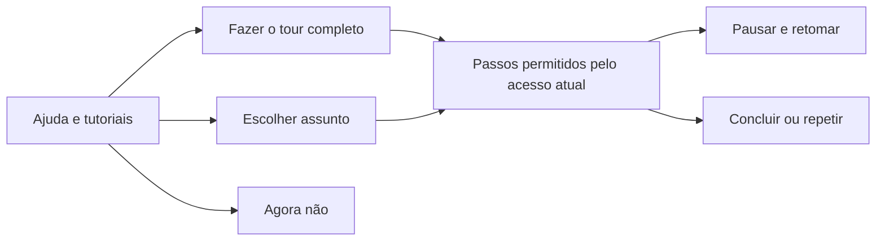

# Primeiros passos no Portal PROEX

Roteiro para os tutoriais. Referência do Portal em 15/11/2026, revisão `a6af672`. Os caminhos usam os rótulos da revisão conferida. O desenho dos cartões e seus controles orienta a próxima implementação.

## Como o Rolê convida

> Oi, sou o Rolê. Quer conhecer o Portal? Você pode fazer um tour, escolher uma área ou voltar quando quiser.

**Fazer o tour completo** · **Escolher assunto** · **Agora não**

- O Início oferece o convite uma vez, sem tomar o foco nem abrir uma janela por conta própria. **Agora não** fecha a oferta. **Ajuda e tutoriais** permanece acessível em **Mais** no celular e na **Conta**. Coloque ajuda local também no atendimento de voluntários e nas páginas da ação pública.
- Quem usa o chat pode abrir a mesma ajuda pelo Rolê. O mascote, os textos, a navegação e o progresso funcionam com conteúdo roteirizado no próprio Portal. Consultar o tutorial não depende de IA ligada, chave, consentimento de provedor, widgets ou saldo.
- Cada cartão tem uma ação, um resultado que a pessoa consegue reconhecer e um caminho de volta. **Voltar**, **Próximo**, **Pausar** e **Sair** continuam disponíveis. Ao terminar, ofereça **Repetir esta parte** e **Ver outros assuntos**. **Retomar** volta ao último passo permitido. **Recomeçar** reinicia só a parte escolhida, com uma opção explícita para reiniciar o tour inteiro.
- **Experimentar** usa um exemplo fictício sem gravar no Portal. **Abrir no Portal** guarda o ponto do tutorial, posiciona o foco no título ou controle visível e deixa qualquer gravação a cargo da pessoa. **Retomar** volta ao percurso. Se nenhum passo continuar disponível, mostre o motivo e volte à lista. Prefira passos que mostrem controles, filtros ou um cartão de exemplo. A trilha pode ser concluída mesmo com uma lista vazia.
- Para cada tela, resolva os passos pela sessão, projeto e capacidade atuais. Distinga consulta, edição, autorização e ações sobre anexos. Se um acesso mudar, reabra no próximo passo permitido. Na área de equipe, encaminhe a Conta → Meus acessos. Em voluntariado, encaminhe a Minha conta ou à coordenação. Na área pública, volte à página da ação ou ao atendimento da ação.
- Grave apenas identificador da trilha, versão, último passo, conclusão e estado do convite, por conta. A versão nova não deve apagar capítulos concluídos que mantêm o mesmo identificador. No público anônimo, progresso local opcional e sem vincular identidade, evento ou anexos desnecessários.

## Trilhas por público

O perfil inicial sugere a ordem. As permissões reais definem o que aparece. A mesma pessoa pode, por exemplo, cuidar de materiais de um projeto e ter só leitura em outro. O rótulo bolsista não define acesso.

| Público | Ordem e exercício final |
| --- | --- |
| Administração geral ou da organização | Conta e escopo → Meu trabalho → Projetos → Demandas e Equipes → Agenda → Pessoas e acessos → operações autorizadas. Ver o alcance de uma designação e de um acesso e explicar a diferença. A administração de uma organização fica no seu escopo. |
| Gestão de projeto | Meu trabalho → Projetos → Demandas → Equipes → Agenda → operações autorizadas. Encontrar o compromisso da ação, a demanda associada e quem cuida dela. |
| Responsável por materiais | Materiais → Projetos → Agenda de materiais → Meu trabalho e Demandas, conforme acesso. Identificar saldo físico, reserva e disponível antes de preencher uma movimentação de exemplo. |
| Responsável por empréstimos | Empréstimos → Agenda → projeto e histórico. Reconhecer se um equipamento está reservado, retirado ou devolvido e simular a próxima ação. |
| Operação de evento | Dinâmicas → ação autorizada → atendimento e retirada de brinde. Reconhecer o evento e conferir um código fictício. A conta com só operação não tem Agenda por essa função. |
| Leitura, incluindo bolsistas sem gestão | Conta → Projetos e Relatórios → Meu trabalho. Encontrar o que lhe foi atribuído. Quando houver autorização específica por demanda, mostrar apenas a atualização permitida. |
| Voluntariado de uma ação | Convite → ação e prazo → Atendimento presencial → Brindes, conforme autorização → Minha conta. Mostrar o que fazer quando o acesso expirar. |
| Participante | Link ou QR da ação publicada → Entrar para participar → cadastro ou confirmação, quando oferecidos → participação. Na ação presencial, mostre o Código do atendimento antes de jogar. Depois, quando houver prêmio, mostre o Comprovante de brinde e como retirar. Mostre atendimento assistido quando oferecido. |

O convite para a equipe usa o e-mail convidado e o recorte concedido. O convite de voluntário é da ação e tem prazo. A entrada de participantes usa a área pública, sem menus internos. Quando alguém pergunta por uma área ausente, indique **Meus acessos** ou a coordenação. Equipes e atribuições organizam o trabalho. O direito de abrir ou alterar registros vem da autorização concedida.

## Roteiro dos cartões

Os textos em itálico são falas do Rolê. Use como base editável após conferir os rótulos na conta que estiver em teste.

| Parte | Fala e passos no Portal | A pessoa conseguiu quando… |
| --- | --- | --- |
| Encontrar os controles | *No celular, as áreas fixadas aparecem na barra e Mais abre a lista. No computador, use o menu à esquerda.* Na área de equipe, abra **Conta → Meus acessos** e encontre um papel ou projeto. No celular, use o avatar e **Minha conta e senha**. Mostre como fixar um módulo usando o alfinete quando aparecer. | Ela sabe voltar ao Início e localizar o menu sem ajuda. |
| Meu trabalho | *Aqui você vê o que chegou para você e para suas equipes.* Em **Suas atribuições**, escolha projeto e alterne **Todas**, **Diretas** e **Por equipe** quando essas opções estiverem disponíveis. Abra uma atribuição e localize o prazo. Diferencie demandas pontuais de responsabilidades contínuas. | Ela abre a demanda ou explica o que mudar no recorte se a lista estiver vazia. |
| Projetos | *Abra a ficha do projeto para reunir atividades, equipe e materiais.* Use a busca e o recorte. Toque **Acessar projeto** e encontre **Cronograma**, **Materiais e atividades** e **Links e documentos**, conforme o acesso. Se aparecer, fixe o projeto pelo alfinete. | Ela encontra uma atividade e volta à ficha sem perder o projeto escolhido. |
| Demandas | *Escolha o projeto e use os filtros para encontrar o que está pendente.* Use **Buscar e filtrar**, estado e prioridade. Abra uma demanda e veja seu histórico. Para quem tem edição, mostre onde criar e editar com um exemplo fictício. Ensine **Somente demandas gerais** apenas se a opção aparecer para a organização administrada. | Ela abre a demanda certa e distingue atribuição, edição e histórico. |
| Equipes | *Uma equipe pode acompanhar mais de um projeto.* Escolha organização ou projeto e abra uma equipe. Confira integrantes e demandas no recorte. Só quem tem a ação permitida recebe o passo **Nova equipe**. A trilha pode mostrar **Quem cuida de cada área** na ficha do projeto e o organograma à gestão autorizada. | Ela diferencia integrantes, unidades e projetos atendidos pela equipe. |
| Agenda | *Escolha o período, a categoria e o dia.* Mostre **Filtrar período e contexto**, **Compromissos de…** e **Ver todo o período**. Indique os horários em Brasília. Abra um compromisso na área de origem quando houver link e acesso. Mostre as exportações do recorte para quem as vê. | Ela acha um compromisso e consegue voltar do detalhe para o recorte. |
| Materiais | *O saldo mostra quanto existe. Disponível mostra quanto pode ser usado agora.* Abra o catálogo e confira material, saldo, reserva e condição. Ensine **Registrar movimento** só a quem pode operar, com origem, destino e referência quando o formulário pedir. Brindes e kits ficam no contexto de quem pode gerenciá-los. | Ela explica o saldo e encontra o histórico certo sem registrar movimento real. |
| Empréstimos | *Uma reserva separa o equipamento no horário combinado. Registre a retirada e, quando voltar, a devolução.* Use a [trilha de Empréstimos](GUIA-EMPRESTIMOS.md). Para quem só consulta, abra o relatório permitido. | Ela identifica a situação, o prazo e o próximo passo sem alterar um registro real. |
| Dinâmicas | *Comece pela ação certa.* Em **Operação presencial**, selecione a ação e confira **Roleta e dado** e **Retirada de brinde** quando disponíveis. Demonstre o código e a confirmação com uma situação fictícia. A preparação de regras, estados e brindes fica no capítulo da gestão. | Ela escolhe a ação e reconhece o que confirma a entrega. |

**Cartão de exemplo — Empréstimos · 2 de 4**

> No exemplo, o projetor aparece como Reservado. Abra Ver histórico para conferir quando a reserva foi criada.

**Você verá** o registro da reserva. **Voltar** · **Experimentar** · **Próximo** · **Pausar**. Ofereça **Abrir no Portal** como ação separada para quem tem acesso.

## Formato e acessibilidade

Um cartão narra uma coisa só e mantém o contexto no topo, como **Agenda · 2 de 4**. Use o design existente do Portal. Combine ícones com verbos e rótulos de estado. Mostre a área pelo nome e por um contorno com contraste. Mantenha alternativa em texto para cada captura. O percurso funciona com Tab, Shift+Tab e teclado. Uma janela modal deve fechar com Escape e devolver o foco à origem. O modo compacto de acompanhamento permite navegar pela página e não cobre botões, textos ou focos. Use alvos de pelo menos 44 px no Portal, teste ampliação, movimento reduzido e temas claro e escuro. [WCAG 2.2](https://www.w3.org/TR/WCAG22/) · [Diálogos acessíveis](https://www.w3.org/WAI/ARIA/apg/patterns/dialog-modal/).

O conteúdo de processos pode aproveitar **Gestão → Guia da organização** e o capítulo de empréstimos. Esse guia pode ser editado e já é consultado pelo Rolê. Use uma referência editorial para o conteúdo e passos ancorados nas ações reais para a navegação. Valide a página e os nomes dos botões a cada mudança relevante. [Guia e ferramentas do Rolê](ROLE-ASSISTENTE.md).

A implementação e a verificação estão em [Passagem, achados e critérios](QA-TUTORIAIS-WIDGETS-E-ROLE.md).
